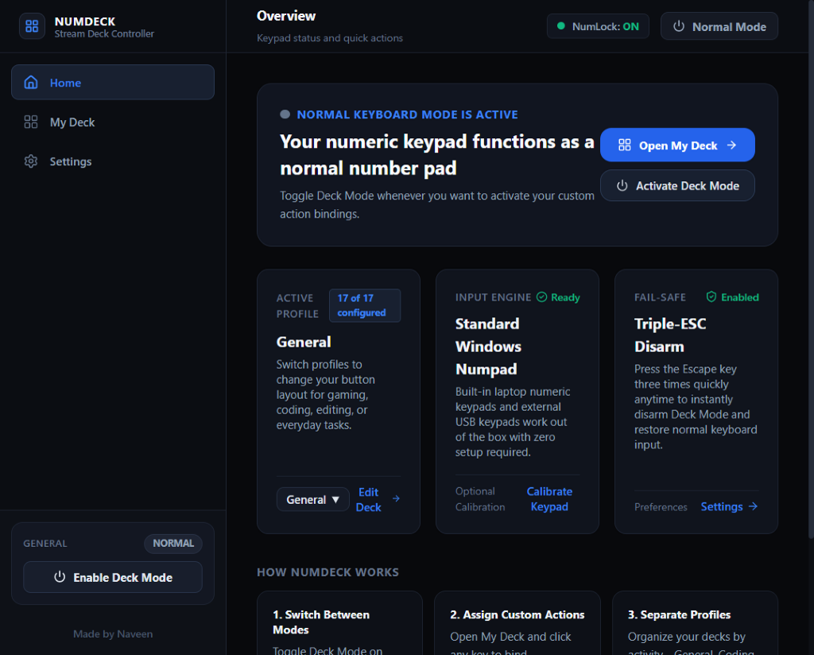

<p align="center">
  
</p>

<p align="center">
  <strong>Turn your ordinary numpad into a customizable Stream Deck-style shortcut controller for Windows and Linux.</strong>
</p>

<p align="center">
  <a href="https://github.com/Naveen-io/NumDeck/releases"></a>
  <a href="https://microsoft.com/windows"></a>
  <a href="https://kernel.org"></a>
  <a href="https://rust-lang.org"></a>
  <a href="https://react.dev"></a>
  <a href="LICENSE"></a>
</p>

---

<p align="center">
  
</p>

## Overview

**NumDeck** transforms any standard physical numeric keypad into a powerful, customizable desktop macro controller—bringing the convenience of expensive macro pads and Stream Decks to your existing laptop keyboard or USB numpad with **zero additional hardware cost**.

Whether you're streaming, coding, gaming, editing video, or navigating spreadsheets, NumDeck gives you 17 dedicated tactile hotkeys right under your right hand while allowing you to toggle instantly back to standard number typing at any time.

---

## Key Features

- **Proportional Physical Numpad Canvas**: A faithful digital representation of your physical keyboard's numeric keypad, including double-height **Enter**, double-height **Add (+)**, and double-width **Zero (0)** keys.
- **Two Operational Modes**:
  - **Deck Mode**: Keys trigger configured applications, URLs, media controls, and multi-key shortcuts with immediate visual and audio feedback.
  - **Normal Mode**: Keypad functions normally for numeric data entry and navigation.
- **Instant Mode Switching**: Switch modes instantly with a single click, via the dedicated Deck Toggle key, or through your system tray.
- **Pre-Configured Workflow Profiles**: Includes ready-to-use layouts out of the box:
  - **General**: Browser, Calculator, Notepad, Terminal, Screenshot, Media Controls, and PC Lock.
  - **Gaming**: Discord, Steam, Spotify, and streaming shortcuts.
  - **Coding**: VS Code, Windows Terminal, Visual Studio, and local dev server shortcuts.
  - **Streaming**: OBS Studio control, Discord mute, and Spotify playback.
  - **Editing**: Adobe Photoshop, Premiere Pro, Blender, and media playback.
  - **Productivity**: Excel, Word, Teams, Slack, and quick snippet paste.
- **Profile Management & Import/Export**: Create, duplicate, rename, backup, and share custom profiles as clean `.json` files.
- **Target Application Association**: Link profiles to specific executable processes (e.g., `code.cmd`, `obs64.exe`, `excel.exe`) for fast recognition.
- **Quick Presets Library**: Assign popular desktop apps and system shortcuts with a single click—no manual path hunting required.
- **Low-Latency Native Rust Input Engine**: Utilizes Windows low-level keyboard hooks (`WH_KEYBOARD_LL`) with physical hardware scan codes (`scanCode`) and cluster extension bits (`LLKHF_EXTENDED`), guaranteeing zero input latency (< 0.05 ms) and 100% isolation from your main keyboard digits and arrow keys.
- **Hardware Keyboard Filtering & Device Isolation**: Choose which physical keyboard NumDeck affects via native Windows Raw Input (`WM_INPUT` + `RIDEV_INPUTSINK`). Isolate a dedicated USB numpad or external keyboard so that your main laptop or primary keyboard types numbers normally without being intercepted. Includes one-click **Detect Keypad** auto-binding.
- **Hardware Fail-Safe Disarm**: Low-level safety protection: triple-tap **ESC** (3 times in under 1.2s) instantly disarms Deck Mode if you ever need immediate emergency keyboard recovery.
- **Optional Calibration**: Ready out of the box for standard keyboards, with an optional 17-key calibration wizard for specialized or custom-layout external keypads.
- **Distraction-Free Desktop UI**: Designed in the style of professional hardware utilities like Elgato Stream Deck software—flat dark slate aesthetics, high-contrast application icons, and zero decorative motion lag.

---

## Home Overview Dashboard

<p align="center">
  
</p>

---

## Keyboard Compatibility

NumDeck works out of the box across all modern Windows configurations:

| Hardware Type | Supported | Notes |
| :--- | :---: | :--- |
| **Built-in Laptop Keypads** | &#10004; | Works seamlessly even when integrated into the main laptop keyboard controller |
| **External USB Numpads** | &#10004; | Plug-and-play with standard OEM scan codes |
| **Wireless / Bluetooth Numpads** | &#10004; | Fully supported via standard Windows HID driver events |
| **Full-size Desktop Keyboards** | &#10004; | Isolates numpad keys from top-row digits and dedicated arrow clusters |
| **NumLock ON / OFF** | &#10004; | Symmetrically handles both numeric and navigation scan codes |

---

## Installation & Downloads

### 🪟 Windows (Windows 10 / 11)

- **Installer (Recommended)**: Download **`NumDeck-Windows-Setup.exe`** from the latest [GitHub Releases](https://github.com/Naveen-io/NumDeck/releases) and follow the quick setup wizard.
- **Portable**: Download **`NumDeck-Windows-Portable.exe`** and launch directly without installing.

---

### 🐧 Linux (Ubuntu, Debian, Fedora, Arch, and more)

- **AppImage (Universal)**: Download **`NumDeck-Linux-x86_64.AppImage`**, make it executable (`chmod +x NumDeck-Linux-x86_64.AppImage`), and run!
- **Debian / Ubuntu Package**: Download and install **`NumDeck-Linux-amd64.deb`**:
  ```bash
  sudo dpkg -i NumDeck-Linux-amd64.deb || sudo apt-get install -f -y
  ```
- **Portable Tarball**: Download **`NumDeck-Linux-x86_64.tar.gz`**, extract, and run `./numdeck`.

> [!NOTE]
> **Linux Feedback Welcome**: I got Linux testing set up for NumDeck, but hardware configurations and desktop environments (X11 / Wayland) vary widely. Your testing and feedback are kindly needed and warmly appreciated! If you test on Linux, please drop a note in GitHub Issues with your distro and numpad model.

---

## How to Use NumDeck

1. **Launch NumDeck**: The application opens in **Normal Mode** with your hardware NumLock state automatically detected.
2. **Explore Profiles**: Select a profile from the top dropdown or open **Profiles** to create your own custom workflow.
3. **Configure Keys**: Click any key on the digital numpad to view its properties in the right inspector. Choose from the **Quick Presets** or click **Configure** to assign custom apps, websites, hotkeys, or text snippets.
4. **Enable Deck Mode**: Toggle Deck Mode via the button in the top bar, the sidebar toggle, or your physical keypad toggle key.
5. **Press Physical Keys**: Press any key on your physical numpad to execute its assigned macro.
6. **Return to Normal Typing**: Disable Deck Mode whenever you need to use your keypad for standard calculations or data entry.

> [!TIP]
> **Emergency Disarm**: If you ever need to disarm Deck Mode instantly from anywhere in Windows, simply tap your keyboard's **Escape key 3 times** in rapid succession.

---

## Developer Guide & Building from Source

### Prerequisites
- [Node.js](https://nodejs.org) (v18 or newer)
- [Rust & Cargo](https://rustup.rs) (1.80+ with MSVC toolchain on Windows)
- Visual Studio C++ Build Tools

### Setup & Compilation

```bash
# 1. Clone the repository
git clone https://github.com/Naveen-io/NumDeck.git
cd NumDeck

# 2. Install frontend dependencies
npm install

# 3. Run in local development mode
npm run dev

# 4. Run unit and integration tests
cargo test --manifest-path src-tauri/Cargo.toml

# 5. Build production executable & installer
npx @tauri-apps/cli build
```

The compiled binaries will be output to `src-tauri/target/release/bundle/nsis/`.

---

## Technology Stack

- **Application Framework**: [Tauri 2](https://tauri.app)
- **Low-Level Engine**: Native [Rust](https://rust-lang.org) with Win32 `WH_KEYBOARD_LL` hooks, non-blocking crossbeam channel dispatch, and `windows-sys` bindings.
- **Frontend Layer**: [React 19](https://react.dev), [TypeScript](https://www.typescriptlang.org), [Tailwind CSS](https://tailwindcss.com), [Lucide Icons](https://lucide.dev).
- **Packaging**: NSIS Windows Installer and standalone portable executable.

---

## License

NumDeck is open-source software licensed under the [MIT License](LICENSE).

Made by **[Naveen](https://github.com/Naveen-io)**.
