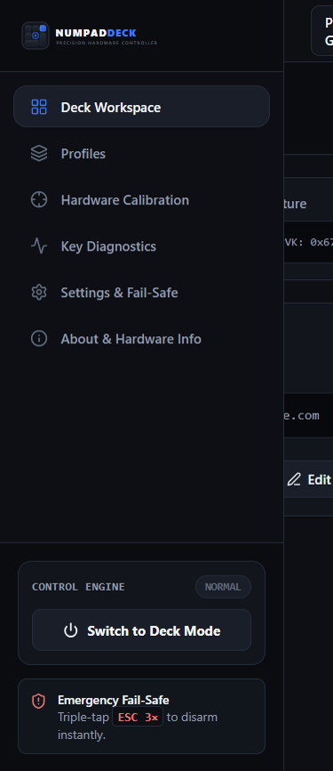

# NUMPAD DECK

> Transform your physical numeric keypad into an automated, hardware-accelerated macro deck for Windows.

[](https://microsoft.com/windows)
[](https://tauri.app)
[](https://rust-lang.org)
[](https://react.dev)
[](https://github.com)
[](https://opensource.org/licenses/MIT)

<p align="center">
  
</p>

---

## 1. Executive Summary & Architecture Reboot

**NUMPAD DECK** has been completely rebuilt from zero to eliminate the keyboard event correlation flaws of previous implementations.

### Why Previous Approaches Failed
Previous attempts attempted to correlate Windows Raw Input (`WM_INPUT`) and Low-Level Keyboard Hooks (`WH_KEYBOARD_LL`) via a shared `latest_device` global variable. This failed fundamentally because:
1. Windows delivers `WM_INPUT` and `WH_KEYBOARD_LL` asynchronously on different timing schedules.
2. An event from one API does not arrive before the other in a guaranteed order.
3. Rapid typing causes race conditions and missed correlations.
4. Laptops integrate numeric keypads into the exact same device ID as the main alphanumeric keyboard, making Raw Input device enumeration useless for isolating numpad keys.

### The Authoritative Architecture
NUMPAD DECK uses a **single authoritative pipeline based on `WH_KEYBOARD_LL`** with raw `KBDLLHOOKSTRUCT` hardware fields:
- **Scan Code (`scanCode`)**: The physical OEM hardware switch index reported directly by keyboard firmware (e.g., `0x47` for physical Key 7, `0x1C` for Enter, `0x35` for `/`, `0x4A` for `-`, `0x4E` for `+`).
- **Extended Flag (`LLKHF_EXTENDED = 0x01`)**: Identifies whether the key is an extended cluster key.
  - **Numpad Enter** has `LLKHF_EXTENDED = 1`; **Main Enter** has `LLKHF_EXTENDED = 0`.
  - **Numpad Navigation Keys (NumLock OFF)** have `LLKHF_EXTENDED = 0`; **Dedicated Arrow/Navigation Keys** have `LLKHF_EXTENDED = 1`.
  - **Numpad Numbers (NumLock ON)** have distinct scan codes (`0x47`–`0x53`) from top-row number keys (`0x02`–`0x0B`).
- **Injected Flag (`LLKHF_INJECTED = 0x10`)**: The hook instantly passes through any synthetic input created via `SendInput`. This strictly prevents recursive execution loops when typing text or sending hotkeys.
- **Off-Thread Action Dispatch**: The hook callback executes in under **0.05 ms** (non-blocking) and queues all actions to a dedicated crossbeam worker thread.
- **Fail-Safe Disarm**: Low-level hardware disarm: **triple-tap ESC** (3 times in under 1.2s) instantly resets the engine to Normal Mode.

---

## 2. Quick Start & Execution

### Standalone Executable (Zero Installation Required)
Launch directly from the repository root:
- Double-click **`NumpadDeck.exe`** (9.70 MB) or **`Start.bat`**
- Memory footprint: **~38 MB RAM** at idle.

### Production Installer
- **NSIS Setup**: `NumpadDeck-Setup.exe` (2.38 MB)
- **MSI Package**: `src-tauri/target/release/bundle/msi/Numpad Deck_1.0.0_x64_en-US.msi` (3.38 MB)

### Development & Build Commands
```bash
# 1. Install frontend dependencies
npm install

# 2. Run automated Rust test suite (verifies key signature isolation)
cargo test --manifest-path src-tauri/Cargo.toml

# 3. Compile frontend bundle
npm run build

# 4. Build release executable
cargo build --release --manifest-path src-tauri/Cargo.toml

# 5. Build full production installers (NSIS + MSI)
npx @tauri-apps/cli build
```

---

## 3. Brand Identity & Visual Design System

NUMPAD DECK features an original industrial design language crafted specifically for precision desktop utilities:

### 1. Palette & Typography
- **Core Dark Matte Palette**: Pure void `#08090C`, structural charcoal `#0D0F14`, surface card `#12151C`, subtle border `#191E28`, interactive border `#252C39`.
- **Focal Accent**: Calibrated cobalt `#397BFF` with subdued focus rings.
- **High-Legibility Neutral Text**: Primary `#F4F6FA`, secondary `#929CAC`, muted `#505A69`.
- **Zero Emojis**: 100% strict policy—no emojis anywhere in navigation, modals, buttons, or status badges.

### 2. Realistic 17-Key Mechanical Workspace
The deck workspace accurately mirrors physical mechanical numpad dimensions:
- **Numpad Add (`+`)**: Tall vertical key spanning 2 rows.
- **Numpad Enter**: Tall vertical key spanning 2 rows.
- **Numpad 0**: Wide horizontal key spanning 2 columns.
- **Tactile Keycaps**: Dual-tone chamfered keycaps, LED state dots, tactile physical labels, and subtle micro-shadows.

### 3. Application & UI Icon System
- **Lucide React**: Integrated vector icon set for all interface navigation, window controls, and actions.
- **16 Official Monochrome Brand Icons**: Custom scalable SVGs for Google Chrome, Microsoft Edge, Mozilla Firefox, Discord, Spotify, Visual Studio Code, Visual Studio, Steam, OBS Studio, File Explorer, Notepad, Windows Terminal, VLC Media Player, Adobe Photoshop, Adobe Premiere Pro, and Blender.
- **Native Executable Icon Extraction**: Select any `.exe` on your system to extract its high-resolution Windows application icon via native GDI and display it directly on the numpad keycap.

---

## 4. Core Features & Capabilities

### 1. Dual Operational Modes
- **Normal Mode**: Keyboard works 100% normally. No keystrokes are intercepted, delayed, or altered.
- **Deck Mode**: Selectively suppresses calibrated physical numpad keys and executes assigned macros/actions. The main keyboard, letters, top-row numbers, main Enter, and arrows remain completely untouched and usable.

### 2. Guided Hardware Calibration Wizard
- Walks the user through each physical key: `7, 8, 9, 4, 5, 6, 1, 2, 3, 0, ., /, *, -, +, Enter, NumLock`.
- Captures live `(vk_code, scan_code, is_extended, numlock_state)`.
- Validates each keystroke to prevent accidental capture of top-row keys, main Enter, or mouse events.
- Stores dual signatures for both **NumLock ON** and **NumLock OFF** states.
- Interactive test playground illuminates keys green as you press them.

### 3. Real-Time Hardware Event Diagnostics
- Live event viewer streaming all `KBDLLHOOKSTRUCT` events.
- Displays: Event type (`keydown`/`keyup`), Key Name, Virtual Key (VK), OEM Scan Code, Extended Key flag, Injected status, NumLock state, Matched logical key, and Suppression status (`Suppressed` vs `Passed Through`).

### 4. Comprehensive Action System
- **Launch Application**: Executables, games, CLI tools with optional arguments (e.g. `calc.exe`, `wt.exe`).
- **Open Path / URL**: Files, folders, URLs, and protocol links (e.g. `https://google.com`, `steam://open/main`, `discord://`).
- **Send Hotkey**: Combinations using `Ctrl`, `Alt`, `Shift`, `Win` + target key (e.g. `Win+Shift+S`, `Ctrl+Shift+Esc`).
- **Type Text**: Direct Unicode string typing without layout distortion.
- **System Media**: Play/Pause, Next Track, Previous Track, Volume Up, Volume Down, Mute/Unmute.
- **Multi-Action Sequences**: Sequential steps with configurable delays (`delay_ms`).
- **Deck Navigation**: Switch profiles or open deck folders.

### 5. Multi-Profile Management
- 5 default profiles included: **General**, **Gaming**, **Coding**, **Editing**, **Streaming**.
- Create, rename, duplicate, and delete profiles.
- Atomic local persistence: safely saved to `%APPDATA%\NumpadDeck\config.json` with automatic backup (`config.json.bak`).

---

## 5. Technologies Used

- **Framework**: [Tauri 2.0](https://tauri.app/) (Rust MSVC native bridge)
- **Backend Language**: [Rust 2021](https://www.rust-lang.org/) with `windows-sys` (Win32 low-level hooks, GDI, Shell API, SendInput)
- **Frontend Stack**: [React 19](https://react.dev/), [TypeScript 5](https://www.typescriptlang.org/), [Vite](https://vitejs.dev/)
- **Styling**: [Tailwind CSS v4](https://tailwindcss.com/) with custom dark matte tokens
- **Icons**: [Lucide React](https://lucide.dev/) + 16 custom brand SVGs
- **Concurrency & Hooking**: `parking_lot::RwLock`, `crossbeam_channel`, native Windows message pump

---

## 6. Technical Verification & Test Results

### Automated Rust Test Suite (`cargo test`)
All 7 unit tests passed with 0 failures:
- `test_numpad_vs_top_row_numbers`: Proves top-row numbers (`0x02`–`0x0B`) are never matched as numpad keys.
- `test_main_enter_vs_numpad_enter`: Proves Main Enter (`Ext: 0`) is distinguished from Numpad Enter (`Ext: 1`).
- `test_dedicated_nav_keys_vs_numpad_nav_keys_when_numlock_off`: Proves dedicated arrow/navigation keys (`Ext: 1`) are distinguished from numpad navigation keys (`Ext: 0`).
- `test_numlock_on_and_off_both_match_same_physical_key`: Proves keys map to the same logical action in both NumLock states.
- `test_custom_calibrated_signature`: Proves custom hardware laptop scan codes match accurately.
- `test_default_profiles_exist`: Proves all 5 default profiles load.
- `test_action_config_serialization`: Proves all ActionConfig types serialize and deserialize losslessly.

---

## 7. Manual Physical Hardware Verification Checklist

*(For user physical hardware testing when you wake up)*

- [ ] **Launch Application**: Double-click `NumpadDeck.exe` in the root folder. Verify window opens at 1280×820 with dark theme.
- [ ] **Inspect Key Diagnostics**:
  - Open **Key Diagnostics** from the sidebar.
  - Press physical numpad keys (e.g. `7`, `8`, `9`). Verify scan codes `0x47`, `0x48`, `0x49` appear.
  - Press top-row numbers (`7`, `8`, `9`). Verify scan codes `0x08`, `0x09`, `0x0A` appear and "Matched Key" displays `-` (unmatched).
  - Press Main Enter. Verify `Ext: 0` appears.
  - Press Numpad Enter. Verify `Ext: 1` appears and matches `numpad_enter`.
- [ ] **Run Calibration Wizard**:
  - Click **Hardware Calibration** in the sidebar.
  - Press each numpad key as prompted. Verify candidate values and confirmation.
  - Test the playground to see keys light up green.
- [ ] **Test Normal Mode**:
  - Open Notepad.
  - Ensure Deck Mode is **OFF**.
  - Type on the numpad. Verify numbers type normally into Notepad.
- [ ] **Test Deck Mode & Selective Suppression**:
  - Toggle **Deck Mode** to **ON** (top bar or sidebar).
  - Open Notepad.
  - Press physical Numpad 8. Verify the assigned Calculator application launches, and NO number '8' is typed into Notepad (suppressed).
  - Press physical Numpad 7. Verify browser opens.
  - Press physical Main Enter and top-row numbers. Verify they still work normally in Notepad (not suppressed).
- [ ] **Test Emergency Disarm**:
  - While in Deck Mode, tap `ESC` 3 times rapidly.
  - Verify Deck Mode toggles to Normal and notification appears.
- [ ] **Test NumLock Toggle**:
  - Toggle physical NumLock button on your keyboard.
  - Verify the top bar and diagnostics update between `NumLock: ON` and `NumLock: OFF`.

---

## 8. Contributing

Contributions are welcome! If you encounter atypical keyboard hardware, unusual scan codes on international keyboards, or want to add presets:

1. Fork the repository.
2. Create a feature branch: `git checkout -b feature/hardware-preset`.
3. Verify all tests pass: `cargo test --manifest-path src-tauri/Cargo.toml` and `npm run build`.
4. Commit your changes: `git commit -m "feat: add support for XYZ keyboard layout"`.
5. Push to the branch and open a Pull Request.

---

## 9. License

This project is open-source under the [MIT License](LICENSE).
