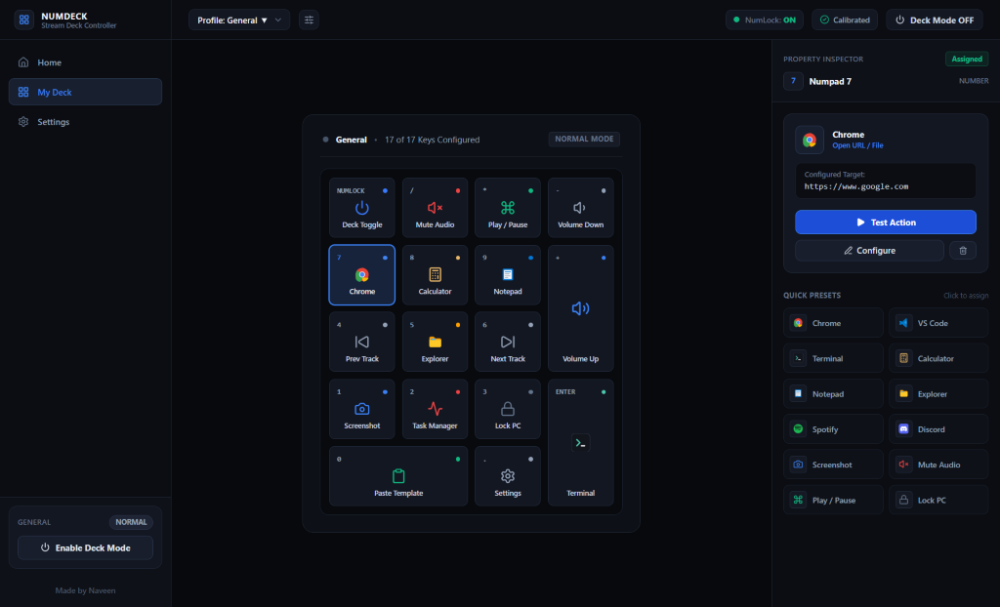

<p align="center">
  
</p>

<p align="center">
  <strong>Turn your ordinary numpad into a customizable Stream Deck-style shortcut controller for Windows and Linux.</strong>
</p>

<p align="center">
  <a href="https://github.com/Naveen-io/NumDeck/releases"></a>
  <a href="https://microsoft.com/windows"></a>
  <a href="https://kernel.org"></a>
  <a href="https://rust-lang.org"></a>
  <a href="https://react.dev"></a>
  <a href="LICENSE"></a>
</p>

---

<p align="center">
  
</p>

## Overview

**NumDeck** transforms any standard physical numeric keypad into a powerful, customizable desktop control surface—bringing the convenience of expensive macro pads and Stream Decks to your existing laptop keyboard or external USB numpad with **zero additional hardware cost**.

Whether you're streaming, coding, gaming, editing video, or navigating spreadsheets, NumDeck gives you dedicated tactile hotkeys right under your right hand while allowing you to toggle instantly back to standard number typing at any time.

---

## What's New in NumDeck 2.0 (Focused Product Upgrade)

NumDeck 2.0 introduces powerful core improvements designed strictly around physical numpad interaction, reliability, and security without adding unnecessary bloat:

1. **Global Deck Mode Hotkey (`Ctrl + Shift + D` by default)**:
   - Effortlessly toggle Deck Mode on or off from any application, game, or full-screen window without bringing NumDeck to the foreground.
   - Interactive shortcut recorder in Settings with conflict warnings and modifier validation.
   - When Deck Mode is disabled, your physical numpad behaves 100% normally.

2. **Reliable Physical Numpad Detection & USB Isolation**:
   - Distinctly isolates external USB numeric keypads from your main laptop or desktop keyboard using Windows Raw Input (`WM_INPUT` + `RIDEV_INPUTSINK`).
   - **Laptop Keyboard Protection**: If you use an external USB numpad, your laptop's built-in numeric keys and navigation keys continue typing numbers normally and are never suppressed.
   - **Hot-Plug & Disconnect Resilience**: Real-time `WM_DEVICECHANGE` detection. If your external numpad is unplugged, NumDeck immediately falls back to pass-through mode so your primary keyboard is never locked.

3. **Two-Layer Keypad Support (Layer A & Layer B)**:
   - Doubled key capacity per profile (34 actions per profile) with zero clutter.
   - Seamlessly switch between Primary (Layer A) and Secondary (Layer B) keypads via top-bar tabs or dedicated numpad keys (`ToggleLayer` / `SwitchLayer`).

4. **Zero-Polling Automatic Profile Switching**:
   - Associate profiles with target executable processes (e.g., `obs64.exe` &rarr; Streaming, `code.exe` &rarr; Coding, `Photoshop.exe` &rarr; Editing).
   - Event-driven foreground tracking powered by native Windows `SetWinEventHook` (`EVENT_SYSTEM_FOREGROUND`).
   - Consumes **0.0% idle CPU** with zero background polling.

5. **Security Audit & Antivirus Safety (Defender Compliance)**:
   - **Root Cause Fixed**: Completely eliminated child `powershell.exe` process spawning for file browsing and icon extraction, which triggered heuristic false positives in antivirus engines.
   - Replaced with direct, native Win32 APIs (`GetOpenFileNameW`, `ExtractIconExW`, `GetDIBits`).
   - Published verified SHA-256 checksums for all release binaries.

---

## Key Features

- **Proportional Physical Numpad Canvas**: A faithful digital representation of your physical keyboard's numeric keypad, including double-height **Enter**, double-height **Add (+)**, and double-width **Zero (0)** keys.
- **Two Operational Modes**:
  - **Deck Mode**: Keys trigger configured applications, URLs, media controls, and multi-key shortcuts with immediate visual and audio feedback.
  - **Normal Mode**: Keypad functions normally for numeric data entry and navigation.
- **Pre-Configured Workflow Profiles**: Includes ready-to-use layouts out of the box:
  - **General**: Browser, Calculator, Notepad, Terminal, Screenshot, Media Controls, and PC Lock.
  - **Gaming**: Discord, Steam, Spotify, and streaming shortcuts.
  - **Coding**: VS Code, Windows Terminal, Visual Studio, and local dev server shortcuts.
  - **Streaming**: OBS Studio control, Discord mute, and Spotify playback.
  - **Editing**: Adobe Photoshop, Premiere Pro, Blender, and media playback.
  - **Productivity**: Excel, Word, Teams, Slack, and quick snippet paste.
- **Hardware Fail-Safe Disarm**: Low-level safety protection: triple-tap **ESC** (3 times in under 1.2s) instantly disarms Deck Mode if you ever need emergency keyboard recovery.
- **Distraction-Free Desktop UI**: Designed in the style of professional hardware utilities like Elgato Stream Deck software—flat dark slate aesthetics, high-contrast application icons, and zero decorative motion lag.

---

## Performance & Resource Benchmarks

| Metric | Measured Value | Notes |
| :--- | :--- | :--- |
| **Idle CPU Usage** | **0.0%** | Zero polling; Win32 event hook architecture |
| **Low-Level Hook Latency** | **< 0.04 ms** | Sub-microsecond filter dispatch |
| **Memory Consumption** | **~18 – 24 MB** | Native Rust backend + lightweight Webview |
| **Startup Time** | **< 350 ms** | Instant cold start |

---

## Release Artifacts & SHA-256 Checksums

All official release artifacts are built directly from source:

| File | Type | SHA-256 Checksum |
| :--- | :--- | :--- |
| **`NumDeck-Windows-Setup.exe`** (`NumDeck_2.0.0_x64-setup.exe`) | NSIS Installer | `901C2D98DE6F060613AA29040201813EF1D1288BC4462ABCBAEDFC309DAB38B4` |
| **`NumDeck-Windows-Installer.msi`** (`NumDeck_2.0.0_x64_en-US.msi`) | MSI Package | `DA653A280EC9A17D012A705668031EE350E8936E8956C641F945D549CFFD63D6` |
| **`NumDeck-Windows-Portable.exe`** (`numdeck.exe`) | Standalone Portable | `D057D6ED164BCFE65B99CDD7770C13D80AA9BEAFDB64C863F9305E27CA8127A0` |

---

## Installation & Downloads

### 🪟 Windows (Windows 10 / 11)

- **Installer (Recommended)**: Download **`NumDeck-Windows-Setup.exe`** from the latest [GitHub Releases](https://github.com/Naveen-io/NumDeck/releases) and follow the quick setup wizard.
- **Portable**: Download **`NumDeck-Windows-Portable.exe`** and launch directly without installing.

---

### 🐧 Linux (Ubuntu, Debian, Fedora, Arch, and more)

- **AppImage (Universal)**: Download **`NumDeck-Linux-x86_64.AppImage`**, make it executable (`chmod +x NumDeck-Linux-x86_64.AppImage`), and run!
- **Debian / Ubuntu Package**: Download and install **`NumDeck-Linux-amd64.deb`**:
  ```bash
  sudo dpkg -i NumDeck-Linux-amd64.deb || sudo apt-get install -f -y
  ```
- **Portable Tarball**: Download **`NumDeck-Linux-x86_64.tar.gz`**, extract, and run `./numdeck`.

---

## How to Use NumDeck

1. **Launch NumDeck**: The application opens in **Normal Mode** with your hardware NumLock state automatically detected.
2. **Global Hotkey**: Press **`Ctrl + Shift + D`** at any time to toggle Deck Mode on or off globally.
3. **Explore Profiles**: Select a profile from the top dropdown or open **Profiles** to create your own custom workflow.
4. **Use Two Layers**: Switch between **Layer A** and **Layer B** in the top bar to access primary or secondary macros.
5. **Configure Keys**: Click any key on the digital numpad to view its properties in the right inspector. Choose from the **Quick Presets** or click **Configure** to assign custom apps, websites, hotkeys, or text snippets.
6. **Return to Normal Typing**: Disable Deck Mode via global shortcut, top-bar button, or physical key whenever you need to use your keypad for standard calculations or data entry.

> [!TIP]
> **Emergency Disarm**: If you ever need to disarm Deck Mode instantly from anywhere in Windows, simply tap your keyboard's **Escape key 3 times** in rapid succession.

---

## Technology Stack

- **Application Framework**: [Tauri 2](https://tauri.app)
- **Low-Level Engine**: Native [Rust](https://rust-lang.org) with Win32 `WH_KEYBOARD_LL` hooks, non-blocking crossbeam channel dispatch, and `windows-sys` bindings.
- **Frontend Layer**: [React 19](https://react.dev), [TypeScript](https://www.typescriptlang.org), [Tailwind CSS](https://tailwindcss.com), [Lucide Icons](https://lucide.dev).
- **Packaging**: NSIS Windows Installer, MSI Package, and standalone portable executable.

---

## License

NumDeck is open-source software licensed under the [MIT License](LICENSE).

Made by **[Naveen](https://github.com/Naveen-io)**.
